# Private & Distributed AI Homelab: Linux Multi-Node Cluster

[](https://opensource.org/licenses/MIT)
[-51a2da?logo=fedora)](https://fedoraproject.org/)
[](https://ollama.com/)
[](https://pipewire.org/)
[-green)](https://github.com/deskflow/deskflow)

Arquitetura distribuída de alta performance para Homelab executando **IA Privada On-Premise**, orquestração de periféricos sob **Wayland nativo (GNOME 51)**, sincronização de clipboard segura entre nós de rede e cluster de áudio multi-room sincronizado em nível de amostra PCM.

---

## 🏗️ Topologia de Hardware e Papéis no Cluster

```mermaid
graph TD
    subgraph LAN["Rede Local Fixa Gigabit (192.168.15.0/24)"]
        direction TB

        subgraph PC["🖥️ Nó 1 — Master Workstation (192.168.15.5)"]
            CPU1["AMD 12 Threads | 16 GB DDR4"]
            GPU1["AMD Radeon RX 7600 (8 GB VRAM)"]
            OllamaPC["Ollama Master (qwen2.5-coder:7b | gemma2:9b)"]
            DeskMaster["Deskflow Server (Porta 4242)"]
            SnapServer["Snapcast Server (Portas 1704, 1705, 4953)"]
            OpenWebUI["Open WebUI (Docker :8080)"]
            Monitors["Display 1: BenQ 24' (DP) | Display 2: AOC 23' (HDMI)"]
        end

        subgraph Notebook["💻 Nó 2 — Edge / Satellite Node (192.168.15.10)"]
            CPU2["Intel 8 Threads | 20 GB DDR4"]
            GPU2["NVIDIA GeForce MX150 (2 GB VRAM)"]
            OllamaNB["Ollama Satellite (bge-m3 Embeddings/RAG)"]
            DeskClient["Deskflow Client (libei / libportal)"]
            SnapClientNB["Snapcast Client (Audio Esquerda)"]
            ScreenNB["Display Integrado 15.6' (Tela Lateral Esquerda)"]
        end

        %% Conexões lógicas
        OllamaPC <-->|Upstream Dual Model| OpenWebUI
        OllamaNB <-->|RAG Embeddings| OpenWebUI
        DeskMaster <-->|libei TCP 4242| DeskClient
        SnapServer <-->|Low Latency PCM Stream| SnapClientNB
        PC <-->|SSH + GTK3 owner-change| Notebook
    end
```



---

## ⚡ Componentes e Destaques Técnicos

### 1. Inferência de IA Distribuída & RAG Local (Ollama + Open WebUI)
- **Nó 1 (PC Master - RX 7600 8GB):** Dedicado à geração de código e raciocínio técnico (`qwen2.5-coder:7b`) e síntese textual (`gemma2:9b`) residentes em VRAM.
- **Nó 2 (Notebook - MX150 2GB):** Descarrega o nó primário executando exclusivamente processamento de embeddings e busca semântica vetorial com `bge-m3:latest`.
- **Open WebUI Integrado:** Centraliza múltiplos endpoints Ollama (`OLLAMA_BASE_URLS="http://host.docker.internal:11434;http://192.168.15.10:11434"`).

### 2. Compartilhamento KVM Sem Fricção no Wayland (`Deskflow` + `Atspi`)
- No GNOME 51 sob Wayland puro, o isolamento de segurança exige confirmação manual do portal `RemoteDesktop/InputCapture`.
- Foi desenvolvido um daemon em Python ([`scripts/auto-accept-input-capture.py`](scripts/auto-accept-input-capture.py)) usando acessibilidade nativa `Atspi 2.0` que autoriza a sessão em <0.5s no boot, tornando a transição do mouse entre as telas imperceptível.

### 3. Sincronização Segura de Área de Transferência (`lan-clip-sync`)
- Superação do isolamento do Mutter via daemon Python ([`scripts/lan-clip-sync.py`](scripts/lan-clip-sync.py)):
  - Conexão direta ao XWayland com extração dinâmica de cookie `.mutter-Xwaylandauth.*`.
  - Validação via hash SHA-256 (prevenção contra echo loops).
  - Túnel encriptado SSH com suporte completo a texto UTF-8 e imagens PNG (prints de tela até 50MB).

### 4. Cluster de Som Multi-Room Sincronizado (PipeWire + Snapcast)
- Pipeline sem perdas em PCM `48000Hz:16bit:2ch`.
- Equalização DSP individual por canal via PipeWire Filter-Chain (Centro nas caixas do PC, Direita no monitor AOC e Esquerda no Notebook).
- Ajuste fino de buffer (280ms) eliminando jitter em streaming TCP entre máquinas.

---

## 📁 Estrutura do Repositório

```plaintext
homelab-ai-cluster/
├── config/
│   ├── deskflow-server.conf          # Topologia e atalhos de emergência KVM
│   └── snapserver.conf               # Fontes de áudio, sinks meta e buffer
├── docs/
│   └── Arquitetura_Referencia.md     # Documento canônico detalhado de infraestrutura
├── scripts/
│   ├── auto-accept-input-capture.py  # Automação de autorização de portal Wayland
│   └── lan-clip-sync.py              # Daemon de sincronização bidirecional de clipboard
├── systemd/                          # Unidades de serviço em nível de usuário
│   ├── auto-accept-input-capture.service
│   ├── deskflow.service
│   ├── lan-clip-sync.service
│   ├── snapcast-volume-sync.service
│   ├── snapclient-pc-box.service
│   ├── snapclient-pc-monitor.service
│   └── snapserver.service
├── LICENSE                           # Licença MIT
└── README.md                         # Documentação técnica e guia do caso de estudo
```

---

## 🚀 Como Replicar no seu Ambiente

### 1. Clonar e Instalar Serviços Systemd
```bash
git clone https://github.com/marcos-data-engineer/homelab-ai-cluster.git
cd homelab-ai-cluster

# Copiar serviços para o diretório de usuário
mkdir -p ~/.config/systemd/user ~/.local/bin ~/.config/Deskflow ~/.config/snapcast
cp scripts/*.py ~/.local/bin/
chmod +x ~/.local/bin/*.py
cp systemd/*.service ~/.config/systemd/user/

# Recarregar e habilitar
systemctl --user daemon-reload
```

### 2. Subir Open WebUI com Upstream Distribuído
```bash
docker run -d \
  -p 8080:8080 \
  --add-host=host.docker.internal:host-gateway \
  -v open-webui:/app/backend/data \
  --name open-webui \
  --restart always \
  -e OLLAMA_BASE_URLS="http://host.docker.internal:11434;http://192.168.15.10:11434" \
  ghcr.io/open-webui/open-webui:main
```

---

## 👤 Autor

**Marcos Vasconcellos de Andrade**  
*Consultor de TI & Especialista em Infraestrutura Linux, Engenharia de Dados & IA Privada*  
- **GitHub:** [@marcos-data-engineer](https://github.com/marcos-data-engineer)  
- **LinkedIn:** [Marcos Vasconcellos de Andrade](https://www.linkedin.com/in/marcos-data-engineer)  
- **Blog:** [Arquitetura de Dados & IA](https://marcos-data-engineer.github.io/blog/)  

---
*Distribuído sob a licença MIT.*
